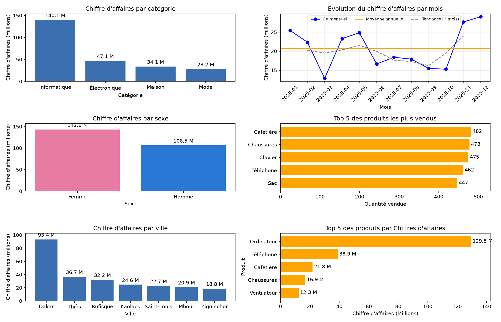

# Analyse des ventes avec Pandas

Projet d'analyse de données réalisé en Python sur un dataset de ventes au Sénégal (année 2025) : exploration, nettoyage, analyse statistique et visualisation.



## Objectifs

- Explorer un dataset brut de ventes et identifier ses problèmes de qualité
- Nettoyer les données : doublons, valeurs manquantes, anomalies, normalisation du texte
- Calculer les principaux indicateurs statistiques
- Visualiser les résultats et en tirer des conclusions

## Le dataset

`dataset_ventes_analyse_pandas.csv` contient **1 215 commandes** et **13 colonnes** :

| Colonne | Description |
|---|---|
| `Order_ID` | Identifiant de la commande |
| `Date` | Date de la commande |
| `Customer_ID` | Identifiant du client |
| `Gender` | Sexe du client |
| `Age` | Âge du client |
| `City` | Ville (Dakar, Thiès, Saint-Louis, Kaolack…) |
| `Product` | Produit acheté |
| `Category` | Catégorie (Informatique, Électronique, Maison, Mode) |
| `Quantity` | Quantité achetée |
| `Unit_Price` | Prix unitaire |
| `Total_Sales` | Montant total de la vente |
| `Payment_Method` | Moyen de paiement (Wave, Orange Money, Carte bancaire, Espèces) |
| `Satisfaction` | Note de satisfaction (1 à 5) |

## Structure du projet

```
├── analyse_ventes.ipynb                        # Notebook d'analyse complet
├── dataset_ventes_analyse_pandas.csv           # Données brutes
├── dataset_ventes_analyse_pandas_cleaned.csv   # Données nettoyées (générées par le script)
├── graphiques_ventes.png                       # Graphiques (générés par le script)
├── requirements.txt                            # Bibliothèques nécessaires
└── README.md
```

## Étapes de l'analyse

### 1. Importation des bibliothèques et chargement du dataset
Pandas, NumPy et Matplotlib.

### 2. Exploration des données
`head()`, `shape`, `info()`, `describe()`, `isna()`, `duplicated()`.

### 3. Nettoyage des données

| Problème détecté | Nombre | Traitement |
|---|---|---|
| Doublons | 15 | Supprimés |
| Valeurs manquantes (`Gender`, `City`) | 12 / 18 | Remplacées par la valeur la plus fréquente |
| Valeurs manquantes (`Satisfaction`) | 20 | Remplacées par la médiane |
| Noms mal écrits (`" Dakar "`, `DAKAR`, `ESPECES`…) | — | Espaces retirés, casse et accents harmonisés |
| Prix ≤ 0 ou manquants | 4 + 10 | Remplacés par la médiane des prix valides |
| Quantités ≤ 0 | 4 | Remplacées par la médiane des quantités valides |
| `Total_Sales` incohérent avec quantité × prix | 353 | Recalculé |
| Âges anormaux (< 18 ou > 90) ou manquants | 5 + 24 | Remplacés par la médiane des âges valides |

### 4. Analyse statistique
Moyenne, médiane, minimum, maximum et écart-type pour l'âge, les quantités, les prix, les ventes et la satisfaction.

### 5. Visualisation
- Chiffre d'affaires par catégorie (barres)
- Évolution mensuelle du chiffre d'affaires (courbe)
- Répartition des moyens de paiement (diagramme circulaire)
- Top 5 des produits les plus vendus (barres horizontales)

### 6. Exportation et conclusion
Export du dataset nettoyé et des graphiques, puis affichage des conclusions.

## Résultats

- **Chiffre d'affaires total :** environ **249,4 millions**
- **Informatique** est la catégorie la plus rentable, avec **56,2 %** du chiffre d'affaires, principalement grâce aux ordinateurs
- **Décembre** est le meilleur mois et **mars** le plus faible : les ventes remontent nettement en fin d'année
- Les moyens de paiement sont équilibrés (24 à 27 % chacun), **Orange Money** arrive en tête
- La **cafetière** est le produit le plus vendu en quantité
- Âge moyen des clients : **41 ans**, satisfaction moyenne : **3,8 / 5**
- Près de **30 %** des ventes d'origine avaient un montant total erroné, ce qui montre l'importance du nettoyage

## Installation et exécution

```bash
# Cloner le projet
git clone <url-du-depot>
cd <nom-du-depot>

# Créer et activer un environnement virtuel
python3 -m venv venv
source venv/bin/activate        # Windows : venv\Scripts\activate

# Installer les dépendances
pip install -r requirements.txt

# Ouvrir le notebook
jupyter notebook analyse_ventes.ipynb
```

Exécuter toutes les cellules dans l'ordre. Le notebook affiche les résultats et les graphiques, puis génère `dataset_ventes_analyse_pandas_cleaned.csv` et `graphiques_ventes.png`.

Le notebook peut aussi être ouvert directement dans VS Code.

## Technologies

- Python 3
- Pandas
- NumPy
- Matplotlib

## Auteur

**El Hadji Birane Cisse Thiam**
